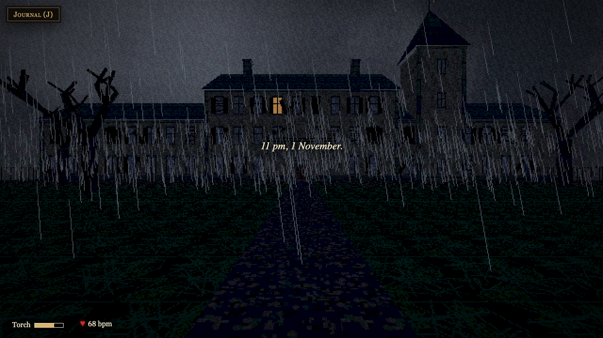
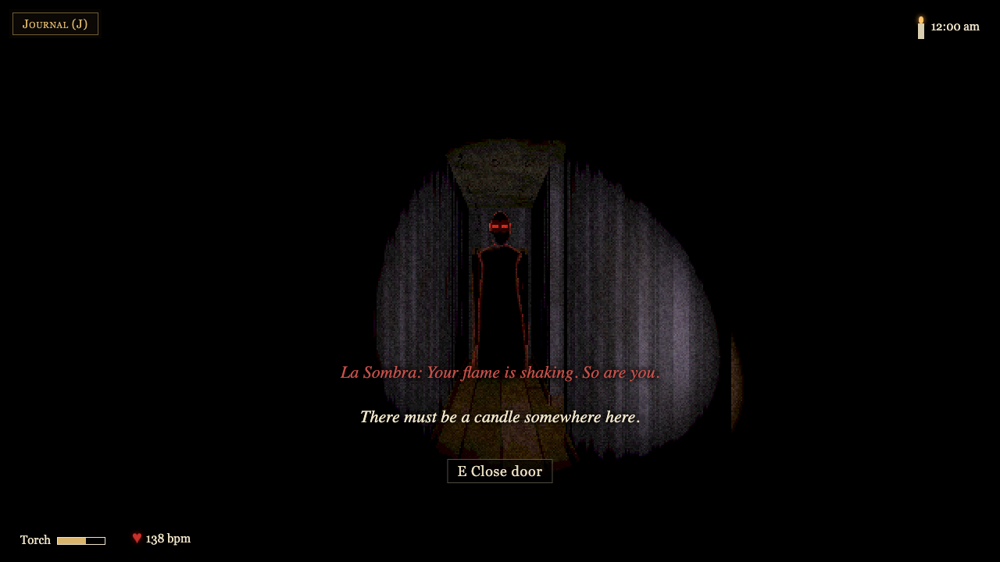
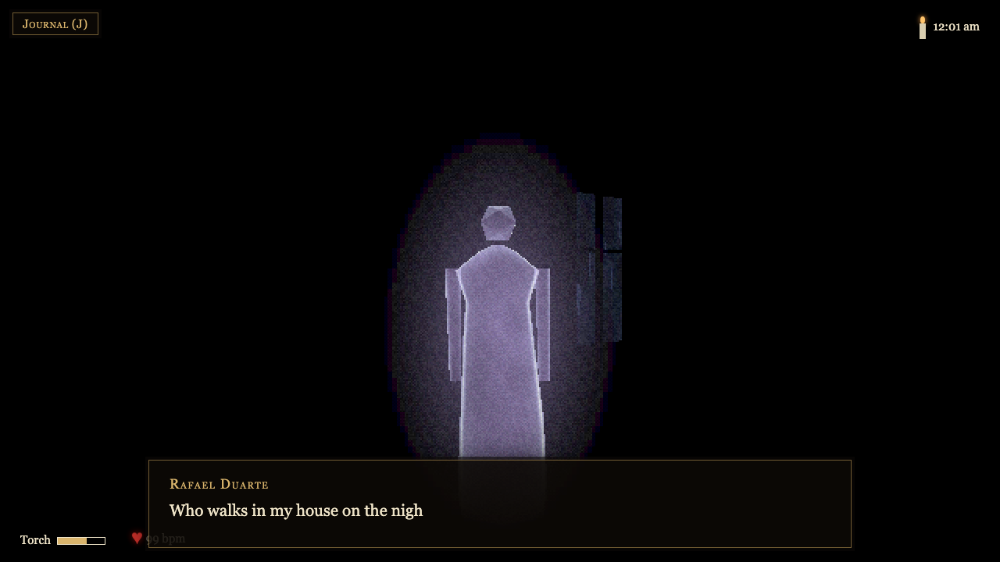
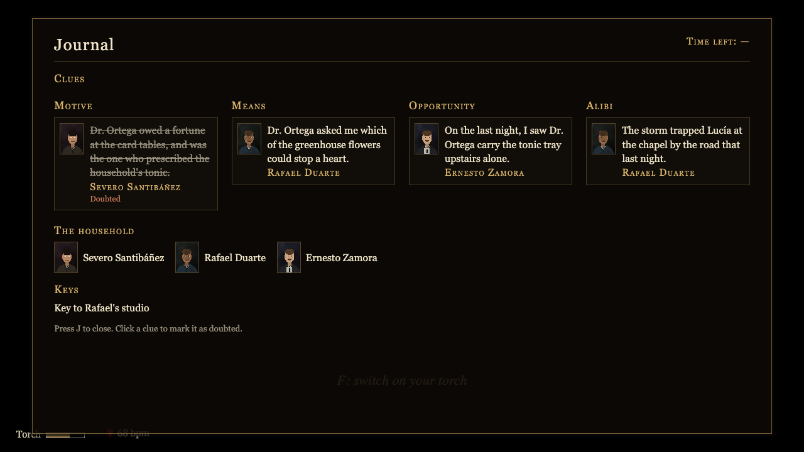
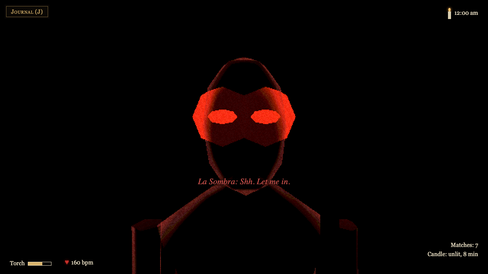

# The Ofrenda House

A first-person 3D horror mystery for Hacktoberfest 2026, played offline on your own Mac.

On the night of 1 November, a stranger takes shelter from a storm in an abandoned mansion. The door locks behind them. Before dawn they must work out which member of the household poisoned the rest. The dead give them clues, one of them is lying, and a faceless shadow, La Sombra, hunts them through a house that rearranges itself wherever the light gives out.

Every run is a new household, a new killer and a new house. The spirits' words come from a local open model (Gemma 3 4B through Ollama) and are spoken by local voices (Piper). Every room, light and sound is generated in code: there are no art or audio files.



| | |
| --- | --- |
|  |  |
|  |  |

Demo video: _TODO: link_

## Play it on a Mac

Only Node is required. Ollama and Piper are optional: **the game plays fully without them.** Without Ollama the spirits speak hand-written lines; without Piper their words appear as captions.

```sh
# 1. Required: Node 26 (or newer) and git
brew install node git

# 2. Get the game
git clone https://github.com/adybose/the-ofrenda-house.git
cd the-ofrenda-house
npm ci

# 3. Optional: spirits that improvise their lines (Ollama + Gemma 3 4B, about 3.3 GB)
brew install ollama
ollama serve &            # or open the Ollama app instead
ollama pull gemma3:4b

# 4. Optional: spirits that speak aloud (Piper + four voices, about 240 MB)
python3 -m pip install --user piper-tts
npm run setup:voices      # creates voices/ and downloads the voice models, once

# 5. Play
npm start
```

Then open **http://localhost:4173** in Chrome, with headphones, and click to start.

`npm start` builds the game, serves it on localhost:4173 and starts the small local server on 127.0.0.1:8787 that talks to Ollama and Piper for the game. It prints what it found and the command for anything missing:

```
The Ofrenda House
  found    Ollama
  found    Gemma 3 4B (gemma3:4b)
  found    Piper voice models (voices/)
  found    Piper

  The game plays fully without any of these.
  Open http://localhost:4173 in Chrome, with headphones. Ctrl+C to stop.
```

Nothing is deployed and nothing leaves your machine while you play. The only downloads are the ones you run during setup (npm packages, the model and the voice models).

## How to play

Get through Act 1, find a candle and matches, then go room to room. Each spirit you find asks a riddle; answer it and it gives you a clue card for your journal (J) and leaves its keys by its candle. One spirit is the killer and lies: find the two clues that don't agree, and name the killer before dawn. Keep a light. La Sombra threatens anyone holding a light and chases anyone in the dark, and if you walk up to it by candlelight, it blows the flame out.

| Action | Keys |
| --- | --- |
| Walk and turn | Arrow keys |
| Look up and down | Mouse (click to lock it), or Page Up and Page Down |
| Run | Shift |
| Open a door, pick up, set down or light a candle | E |
| Torch on or off | F |
| Strike a match (lights the candle you hold) | M |
| Blow out your candle | B |
| Clue journal | J |
| Pick an answer | Click it, or press 1 to 4 |

## Debug flags

Add these to the URL, for example `http://localhost:4173/?seed=42&skip=act1`.

| Flag | What it does |
| --- | --- |
| `seed=N` | Replay a run: the same household, killer and house |
| `skip=prologue`, `skip=act1`, `skip=exit` | Start in the hall, at midnight, or holding every clue and the way-out key |
| `shadow=0` | Keep La Sombra asleep |
| `sombra=door`, `sombra=candle` | La Sombra steps out at every door, or whenever you walk by candlelight |
| `guide=N` | A guiding whisper every N seconds |
| `matches=N`, `battery=0.2` | Matches in the box; torch charge, 0 to 1 |
| `mute=1` | No sound |
| `debug=hooks,shadow,items,…` | Test handles on `window` (used by the Playwright tests) |

## How it was built

The game was built in four days with [Claude Code](https://claude.com/claude-code), specification first:

- [`docs/story.md`](docs/story.md) is the story bible and [`docs/build-plan.md`](docs/build-plan.md) the stack and build order.
- [`CLAUDE.md`](CLAUDE.md) holds the constitution: everything offline, the case file owns the facts and the model only writes words, every model or voice call has a fallback, pure logic is seeded and unit-tested.
- Each feature is a spec in [`specs/`](specs/) with acceptance checks. Each was built on its own branch, tests first, and merged only when its checks passed, with Playwright screenshots as proof for anything visual.

Stack: TypeScript, three.js, Vite, Fastify (the local server), Vitest and Playwright.

```sh
npm run dev      # game (Vite, with hot reload) and local server together
npm run check    # lint, type check and unit tests
npm run e2e      # Playwright browser tests (Ollama and Piper are mocked)
```

## Troubleshooting

- **"missing Piper" though you installed it:** pip may have put `piper` somewhere not on your PATH. Run `PIPER_BIN=/path/to/piper npm start`.
- **Port already in use:** stop whatever uses port 4173, or run the local server on another port with `PORT=8799 npm start` (the game follows it).
- **A spirit's first line is slow:** the model loads on first use. The game waits a few seconds, then falls back to a written line.
- **No sound:** click the page once; browsers start audio only after a click.

## Licence

[MIT](LICENSE)
