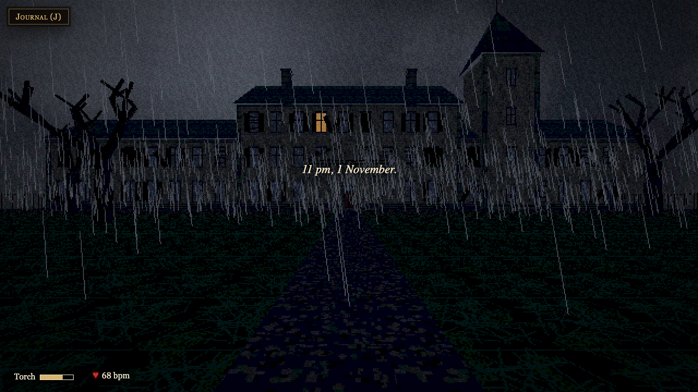
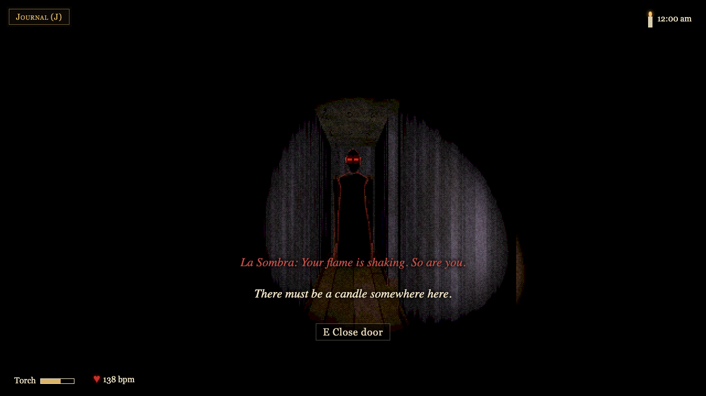
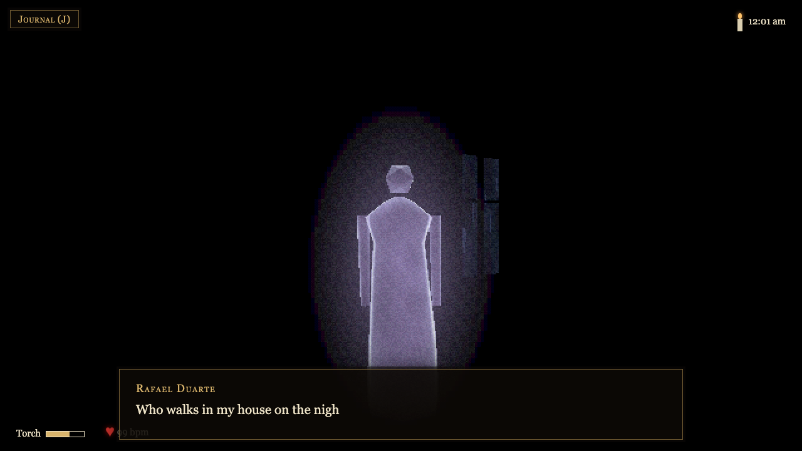
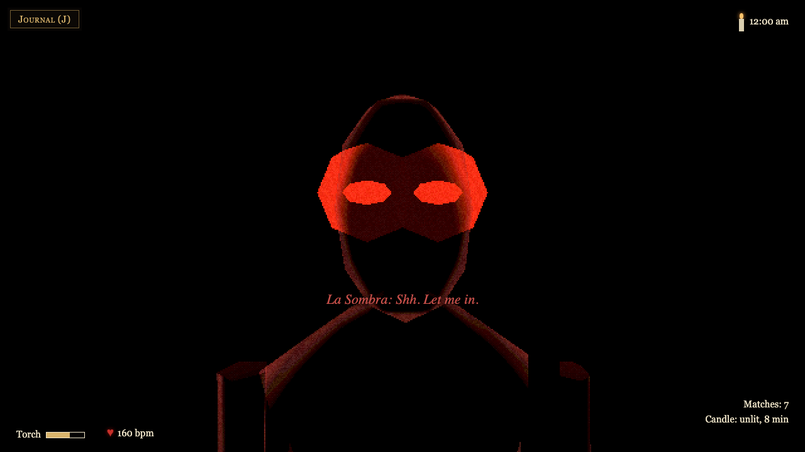

*This is a submission for the TODO: challenge name.*

## What I Built

**The Ofrenda House** is a first-person 3D horror mystery that runs entirely on your own Mac.

On the night of 1 November, a stranger takes shelter from a storm in an abandoned mansion. The door locks behind them. In 1931 the household died one by one of a "wasting fever", but in truth one of them was poisoning the rest. Before dawn, you have to work out who.

- **The dead talk.** Each spirit you find asks you a riddle, and answering it earns a clue for your journal. Their lines are written live by Gemma 3 4B running in Ollama and spoken aloud by Piper voices, pitched and echoed so they sound like ghosts.
- **One of them is lying.** The killer is hiding among the friendly spirits and misstates one fact. Finding the two clues that don't agree is how you catch them.
- **A faceless shadow hunts you.** La Sombra whispers through the walls, drops chandeliers in front of you and kills your torch. If you hold a light it only threatens you; if it finds you in the dark it chases you. Walk up to it by candlelight and a cold gust blows the flame out, and you have a heartbeat to strike a match.
- **The house never ends.** Rooms rearrange themselves wherever you can't see them, so you can't map your way out.
- **Every run is new:** a new household, new secrets, a new killer and a new house, all from one seed.
- **Nothing is downloaded at play time.** There are no image or sound files: every wall, portrait, candle, raindrop, footstep, thunderclap and the piano stinger is generated in code.

It is fully offline. With Ollama and Piper switched off, the spirits fall back to hand-written lines shown as captions, and the game is still complete.

## Demo

TODO: video link (60 to 120 s: the arrival, an encounter, a candle in the dark, La Sombra, an ending)

## Code



To play: `npm ci && npm start`, then open http://localhost:4173. The README covers the optional Ollama and Piper setup.

## How I Built It

I built it in four days (28 to 31 October 2026) with Claude Code, and the most useful decision was to write everything down before any code existed.

**A story bible, a build plan and a constitution.** `docs/story.md` holds the whole story: the backstory, the household, the acts, the endings and the controls. `docs/build-plan.md` sets the stack and the order of work. `CLAUDE.md` holds the rules Claude Code had to follow on every change:

- Everything runs offline: no cloud APIs, no CDN, no art or audio files.
- The case file owns the facts and the LLM only writes words. Nothing the model says is trusted until it has been checked against a schema.
- Every LLM or text-to-speech call has a fallback.
- Pure logic (generators, the case file, dialogue rules) is seeded, deterministic and unit-tested.

**Specs, one branch each.** Every feature started as a spec in `specs/`: requirements in "WHEN … THE SYSTEM SHALL …" form, what was out of scope, and acceptance checks. Work began in plan mode, tests came first, and a box was ticked only when a test or a screenshot proved it. Each spec lived on its own `spec/NN-name` branch and was merged only when its checks passed. There are 27 specs, from the scaffold to the release, and when playing showed a spec was wrong, the spec changed first and then the code.

**Playwright as eyes.** For anything visual, Claude Code ran the game in headless Chromium, drove it with debug URL flags (`?seed=42&skip=act1&debug=shadow`) and saved screenshots, which I reviewed. The same tests check the audio by rendering every synthesised sound offline and measuring its levels. A guard in every test fails if the page ever requests anything outside localhost.

**The LLM never decides anything.** The case file (who died, who lied, which clue contradicts which) is generated by seeded code. Ollama only writes the words a spirit says, given a persona card and the facts it may reveal. Answers are checked against a JSON schema and a deadline, and anything late or wrong falls back to a hand-written line. Lines for the next room are prefetched while you walk.

**Playing it, then tuning it.** The last two days were mostly playing and fixing what didn't feel right: a heavier piano stinger, a score that swells with your fear, bats that fly at your face, chandeliers that come down in front of you, whispers that lead you to the spirits (and a bug where they fell silent once you held a key), and La Sombra punishing a player who walks straight into it.

By the end: about 100 commits, 331 unit tests and 94 Playwright tests, all running without Ollama or Piper.

**Stack:** TypeScript (strict), three.js, Vite, a small Fastify server on localhost (the bridge to Ollama and Piper), Vitest, Playwright, Ollama with Gemma 3 4B, and Piper.

## What's next

More roles and riddles in the household pool, a second house layout style, and a proper demo of the true ending.

Thanks for reading, and play it with headphones.
